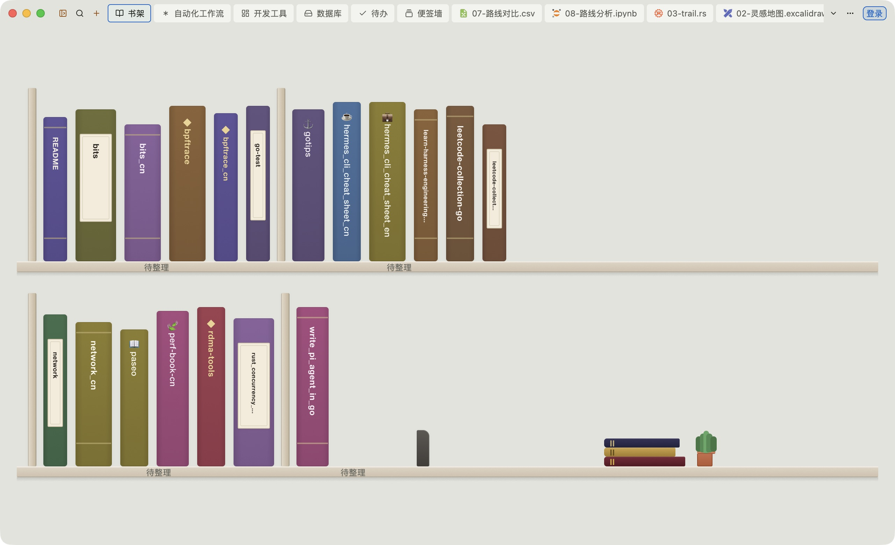
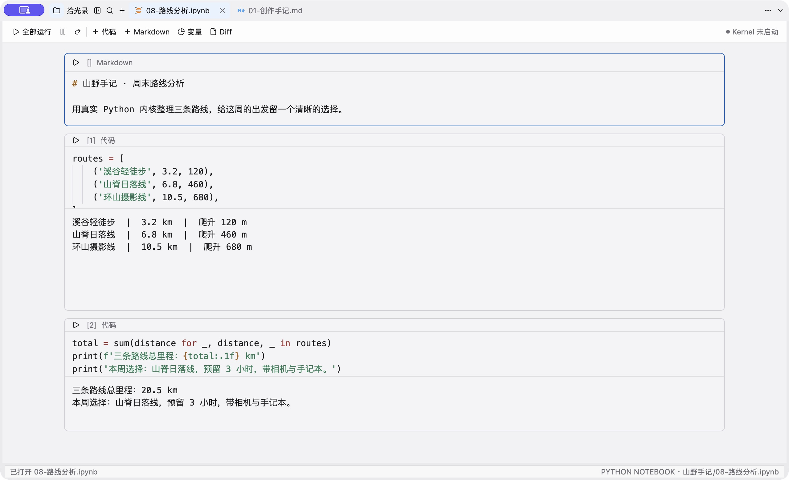
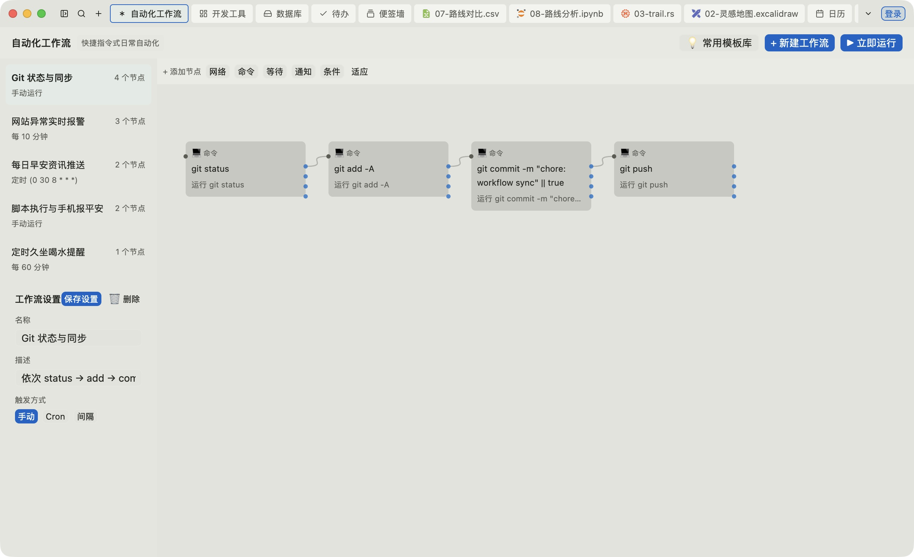

# 思芽岛官网源码

访客站点仓库：讲清楚「思芽岛能做什么」、引导下载与试用样例。  
**线上：** [中文站 studio.siyadao.cn](https://studio.siyadao.cn/) · [英文站 siyadao.github.io](https://siyadao.github.io/)

> 安装包与 Issue 在发行仓 [siyadao/studio](https://github.com/siyadao/studio)；桌面源码在 [siyadao/ai-studio](https://github.com/siyadao/ai-studio)。本仓不放应用二进制。

---

一台原生桌面工作台，把记录、写作和工程放在同一窗口。默认空间可完全离线；账号与内容同步是可选项，按类别勾选。

<p align="center">
  
</p>
<p align="center"><em>默认空间里的书脊书架 —— 打开就能继续写、画、编</em></p>

## 先记下来，再接着做

灵感不用先开工程。便签可贴在屏幕边；待办拆成下一步；月历与日视图把笔记串成可回看的一天。

<p align="center">
  
</p>

需要分享时，文稿旁可打开公众号竖屏预览；白板承接草图与导图；Rust / Go / Python 带着语言服务、Git 与真实终端。数据库、表格、工具集和密码库按需打开。

<p align="center">
  
</p>

浅色 / 深色成对实拍在 [`public/screenshots/`](public/screenshots/)，拍摄记录见 [`provenance.json`](public/screenshots/provenance.json)。演示内容来自「山野手记」隔离空间。

## 下载与试用

1. 打开 [中文站下载区](https://studio.siyadao.cn/#download)（或本页英文站同入口），按平台取当前公开发布包。  
2. 也可直接去 [GitHub Releases（studio）](https://github.com/siyadao/studio/releases)。  
3. 想先摸清工作流：下载 [创作样例 zip](public/samples/siyadao-samples.zip)，或浏览源文件 [`samples/山野手记/`](samples/山野手记/)。

支持 macOS / Windows / Linux 常见架构；具体附件以当次 Release 为准。

## 本仓怎么预览

静态页，无 npm。根目录：

```sh
python3 -m http.server 3001 --bind 127.0.0.1 --directory .
```

访问 <http://127.0.0.1:3001/>。推送 `main` 后由 Actions 发布英文站到 GitHub Pages。检查清单见 [LOCAL_PREVIEW.md](LOCAL_PREVIEW.md)。
