# 思芽岛 · Siyadao

**让想法，即刻发生。**

原生桌面工作台：便签、待办、日历与笔记时间线，连接写作、白板、代码、数据和自动化。个人空间可离线使用；需要时再登录，按类同步内容。

<p align="center">
  
</p>

<p align="center">
  <a href="https://studio.siyadao.cn/">中文官网</a>
  ·
  <a href="https://siyadao.github.io/">English site</a>
  ·
  <a href="https://studio.siyadao.cn/#download">下载安装包</a>
</p>

截图均为应用实拍（浅色 / 深色成对收录于 [`public/screenshots/`](public/screenshots/)），演示空间「山野手记」。

---

## 日常记录

灵感、计划与日程在同一工作台里衔接。

| 便签墙 | 待办 |
| :---: | :---: |
| 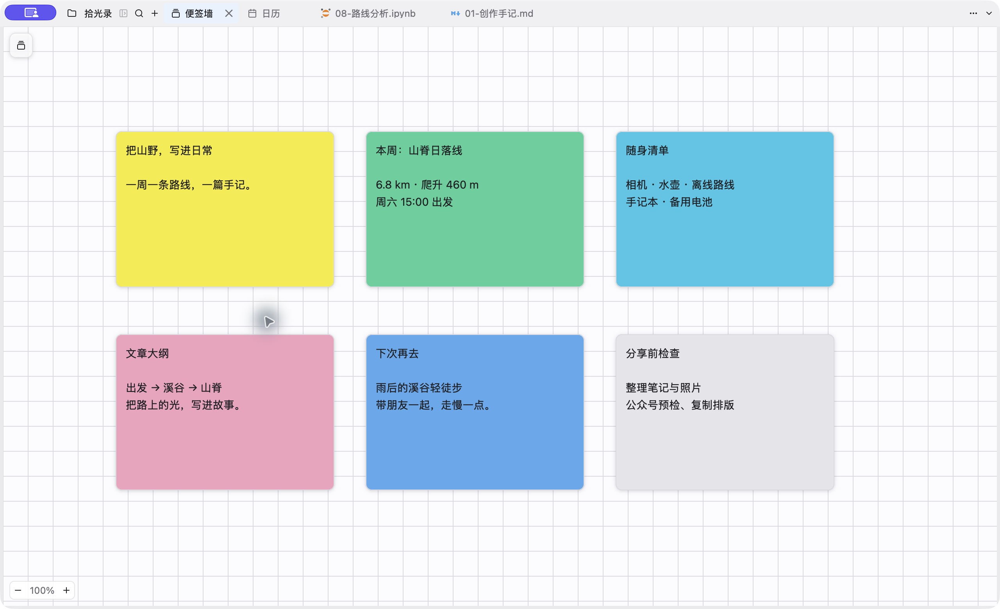 | 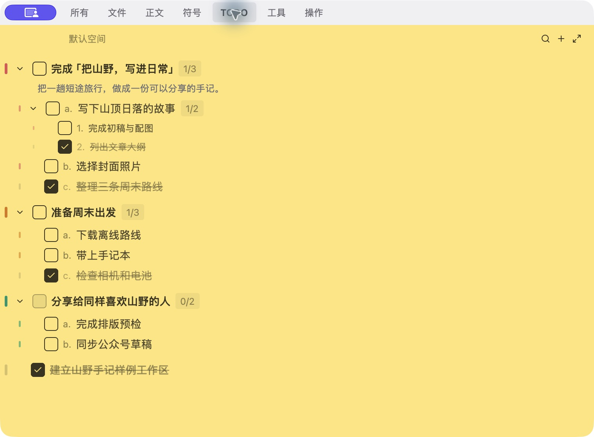 |
| 彩色分类、自由摆放；可定住到屏幕右缘或挂到当前文件 | 分组、子任务与归档；支持 Markdown 导入导出 |

| 日历 | 笔记时间线 |
| :---: | :---: |
|  |  |
| 月历串起每日记录，可复用模板与提醒 | 日视图左侧按时间打开笔记，重要篇目可盯住置顶 |

---

## 创作与开发

从文稿、画布到代码与数据，同一窗口继续做下去。

### 文稿与手机预览

写 Markdown / 公众号稿时，可在编辑器旁打开竖屏预览，先看排版再复制或发布。

<p align="center">
  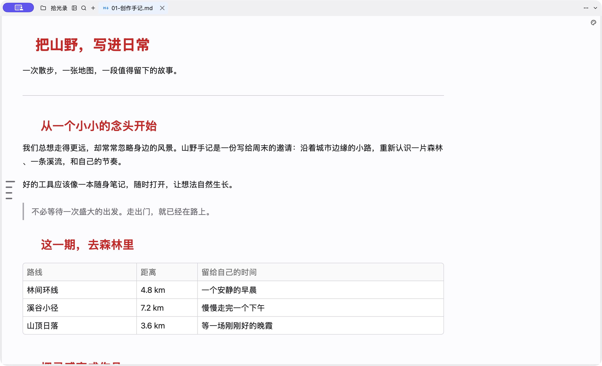
</p>
<p align="center">
  
</p>

### 白板 · 代码 · Notebook

| 白板 | 代码 |
| :---: | :---: |
| 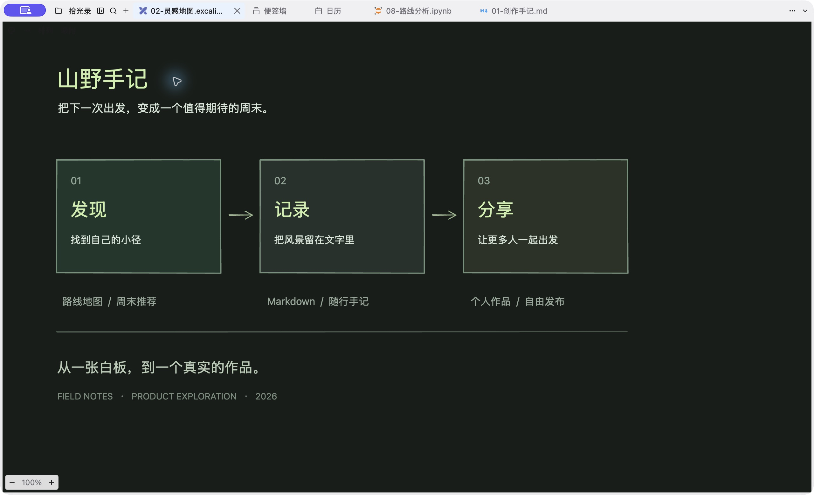 | 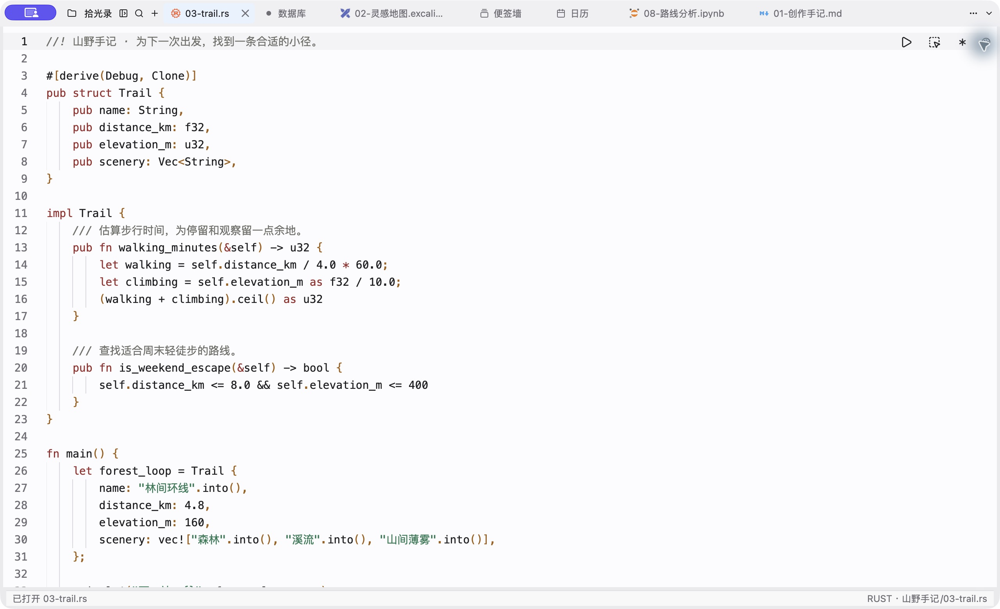 |
| 原生 `.syd` 画布、Excalidraw；思维导图可读存 XMind | Rust / Go / Python，语言服务、搜索、Git 与真实终端 |

<p align="center">
  
</p>

---

## 更多能力

| 数据库 | 表格 |
| :---: | :---: |
| 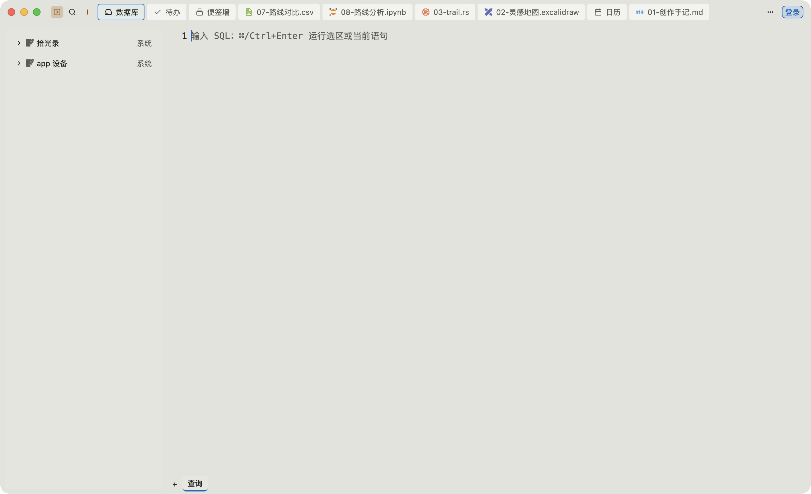 | 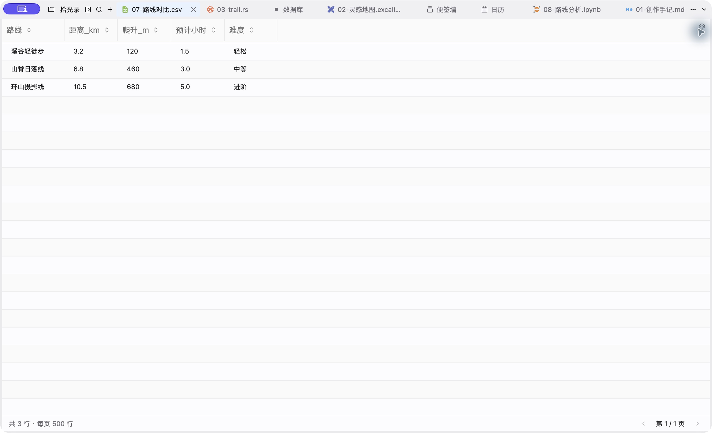 |
| SQLite、PostgreSQL、MySQL 等，浏览对象并写 SQL | 查看编辑 CSV / TSV，复制单元格或整行 |

| 工具集 | Git |
| :---: | :---: |
| 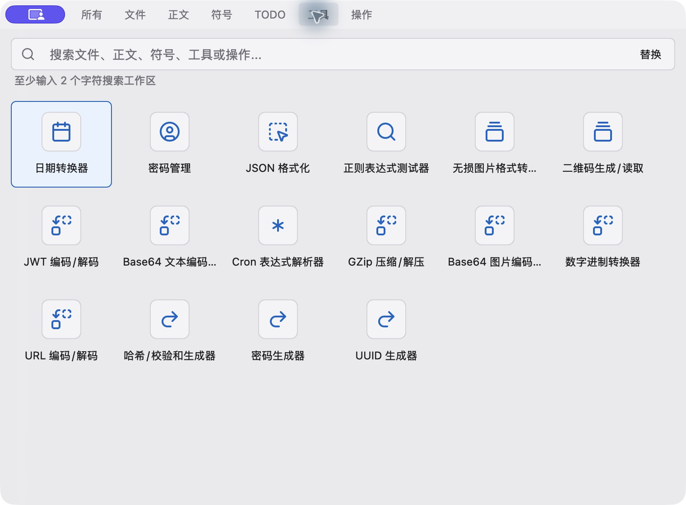 | 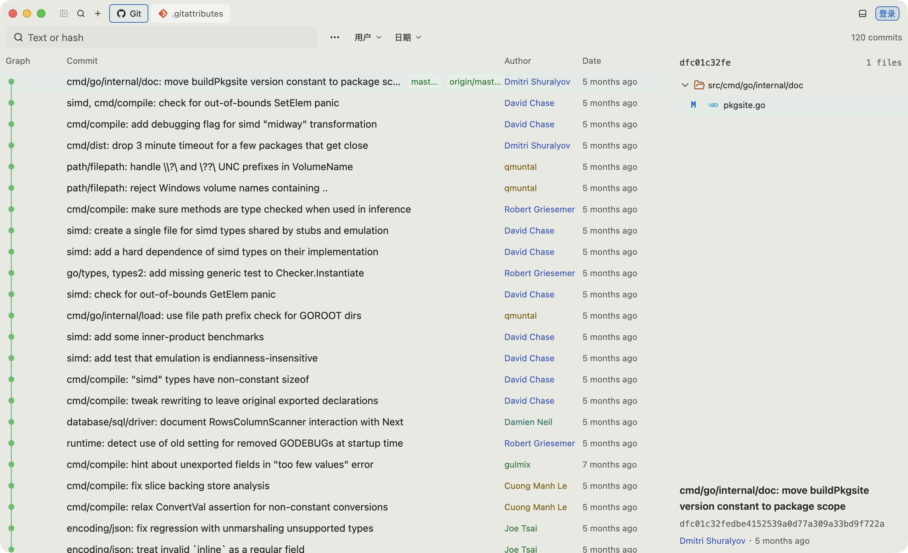 |
| JSON、时间戳、编码、二维码、正则等 15 项；密码库单独打开 | 变更、历史与提交留在项目工作流里 |

本地开始、按需连接账号；外观、文稿排版与中英文可在设置中切换。

<p align="center">
  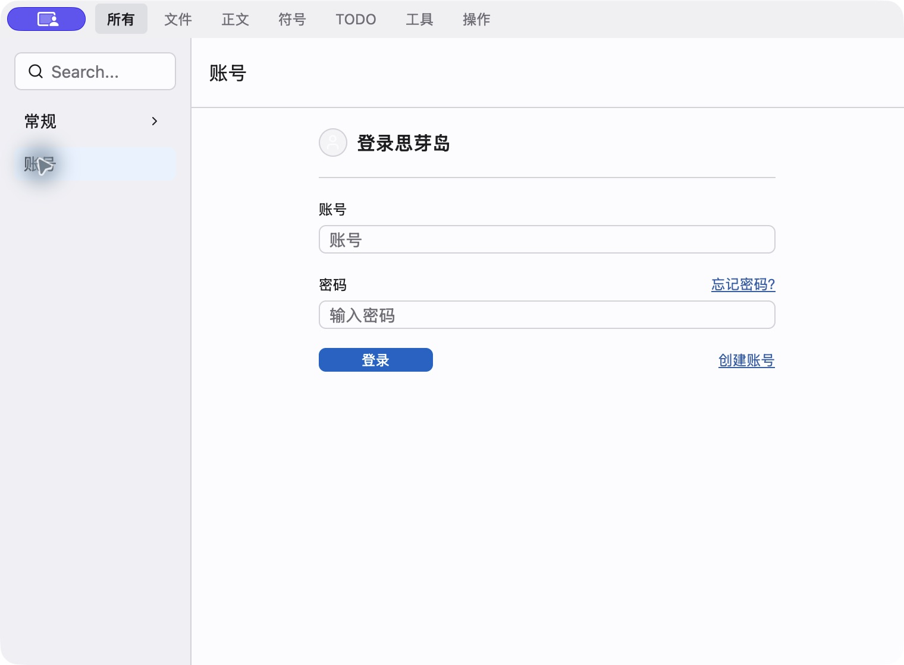
</p>

深色主题同场景见 `*-dark.jpg`，例如：

<p align="center">
  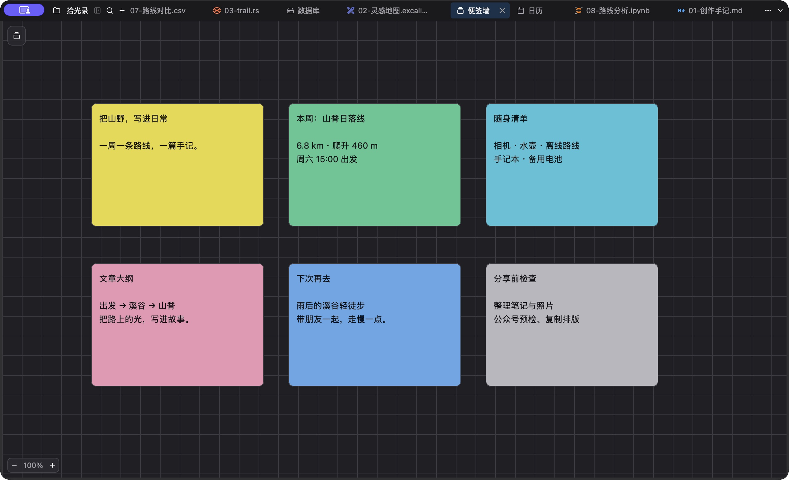
  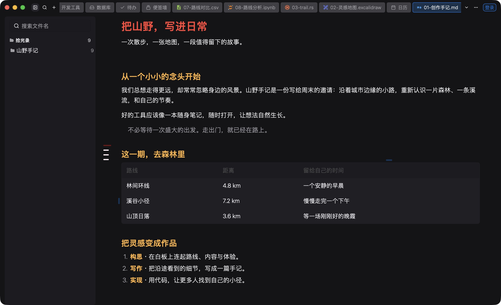
  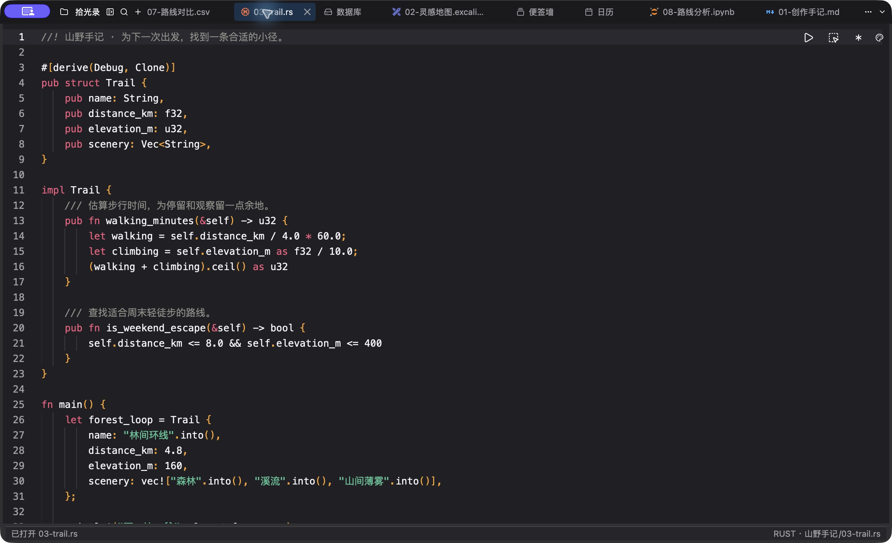
</p>

---

## 下载与样例

- **平台**：macOS（Apple silicon / Intel）、Windows（x64 / ARM64）、Linux（x64 / ARM64）
- **版本列表**：官网下载菜单读取公开发布接口；推送 `main` 后，本仓 Actions 组装并发布 **英文站** 到 GitHub Pages
- **创作样例**：[samples/山野手记/](samples/山野手记/)（源文件）· 打包副本 [`public/samples/siyadao-samples.zip`](public/samples/siyadao-samples.zip)

---

## 本仓

静态官网源码（原生 HTML / CSS / JS，无打包）。本地预览：

```sh
python3 -m http.server 3001 --bind 127.0.0.1 --directory .
```

打开 <http://127.0.0.1:3001/>。细节与验收项见 [LOCAL_PREVIEW.md](LOCAL_PREVIEW.md)；截图出处见 [`public/screenshots/provenance.json`](public/screenshots/provenance.json)。
